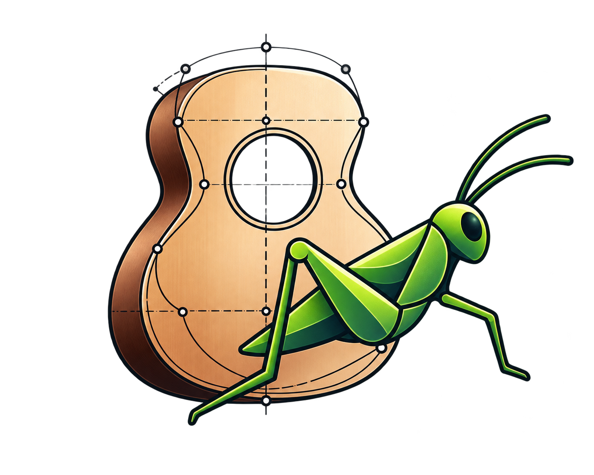

# GuitarForm



A guitar designer for **Rhino 8**. A dockable panel has a tab for each section of the guitar, such as the instrument, body and soundhole. Designs are saved in a library on your computer, with saved copies of the body, neck and bracing and automatic backups. Edits are kept in a working copy until you **Save**. The design is previewed live in Rhino as you type, and built into the document when you're ready.

## Requirements

- Rhino 8 (Windows), running on its default .NET runtime. The plug-in won't load if Rhino has been switched to .NET Framework with `SetDotNetRuntime`.
- .NET SDK 8 or later, to build.

## Build

From the repository folder:

```
dotnet build GuitarForm/GuitarForm.csproj
```

The plug-in is written to `GuitarForm/bin/Debug/net7.0-windows/GuitarForm.rhp`, with the libraries it needs beside it. Keep them together.

## Load in Rhino

**Option A: drag and drop.** Drag `GuitarForm.rhp` from the build folder into Rhino. Rhino installs it and loads it again each time it starts. Close Rhino before rebuilding, because it locks the `.rhp`.

**Option B: Visual Studio (best while developing).** Open `GuitarForm.sln` and press **F5**. The **Rhino 8** launch profile (`GuitarForm/Properties/launchSettings.json`) builds the plug-in, starts Rhino 8 with the build folder in `RHINO_PACKAGE_DIRS` so it loads without being installed, opens the GuitarForm panel and attaches the debugger. If Rhino is installed somewhere other than `C:\Program Files\Rhino 8`, change `executablePath` in the launch profile.

Then run the **`GuitarForm`** command to open the panel. Dock it by dragging its tab into the panel area beside Properties and Layers: a floating panel hides whenever another app has focus.

## Using the panel

- **Design:** pick a design from the list, or use **New…** (asks for the name, body length, scale length and neck join fret), **Copy**, **Rename…** and **Delete**. **More ▾** holds **Import…** and **Export…** (a JSON design document; Export writes the working copy). Rename applies when you save.
- **Working copy and saving:** edits change a working copy of the open design, not the library, and the **Unsaved changes** label beside the design list shows while there are any. **Save** (enabled while there are changes) writes them to the library. **Save as…** saves the working copy as a new design and switches to it, leaving the original as it was. **Revert** throws the changes away, after asking. The first Save after opening a design asks whether to overwrite it (**Yes**), save as a new design (**No**), or do neither (**Cancel**). A design you've just made with New, Copy or Import doesn't ask.
- **Unsaved changes:** switching design, **New…**, **Copy**, **Import…**, **Delete**, or moving or restoring the library in Settings asks whether to save them (**Yes**), discard them (**No**) or cancel. Unsaved work is also kept in a recovery file (in `%LOCALAPPDATA%\GuitarForm\recovery`, apart from the library), so if Rhino closes before you save, the panel offers **Recover unsaved changes?** the next time you open that design.
- **Section tabs:** each section's values in groups. The Messages bar below the tabs shows the selected tab's errors, warnings and notes, each in its own color. It hides when the tab has none, and its header collapses it. A tab's title shows its number of errors, e.g. **Body (2)**. Click a group's title to collapse or open it. Fields are labeled as in the Glossary (e.g. Body Length (BDL)); hover a label or box for its description, unit and limits. A required box shows "required" while blank, and Save, Export and Build are refused until it is filled in.
- **Sliders:** a decimal value sits on the lever of a slider, which fills the field's width. Drag the lever to change it in steps (tenths; hold Shift for hundredths, or Ctrl for ten steps at a time); it springs back to the middle when let go. When a field has focus, the arrow keys step it, with the same Shift and Ctrl. Click the lever to type a value, or click the track beside it to step once. Length slider steps follow the document units (a 0.1 mm step becomes 0.1 mm converted, so in an inch document it is a smaller fraction of an inch). Hover over a field for its description and range. Optional fields can be left blank; the drawing shows whatever the values set so far allow.
- **Saved copies:** the Body, Neck and Bracing tabs each have a **Saved … copies** row at the top, which stays put while the fields scroll. **Save as…** asks for a name and saves the open design's body, neck or bracing under it straight away (a name already used for that part is refused). **Load** copies the saved values into the design, so changing the copy later doesn't change the design; loading counts as an edit, so it needs a Save. **Delete** removes a saved copy. A saved body includes its top plate, soundhole and the bracing on it; a saved neck includes its fretboard, and the fretwire and string set it uses. There are no Instrument or Soundhole copies.
- **Preview:** the working copy is drawn in the viewports as you type, while the panel is visible and **Preview** is ticked. Unsaved changes show. Each part is drawn in its component's color, as Build will make it (see [Layers and colors](#layers-and-colors)).
- **Show strings:** a tick box at the top of the Fretboard tab. It hides or shows the strings in the preview and in Build. It's a setting for all designs, kept between sessions, not part of the design.
- **Build:** writes the working copy into the document, on the `Guitar` layer tree (see [Layers and colors](#layers-and-colors)). Build's message says when the design has unsaved changes. Building a design again replaces its previous build. One Undo removes a build.

The guitar is drawn **vertically**: the tail end of the body is at the origin and the body length runs up the **+Y** axis. The side view is drawn to the right of the plate.

### Units

Every length in GuitarForm is shown and typed in the **Rhino document's units**, and the unit is shown beside each field. GuitarForm stores everything in **millimeters**, so a design means the same in any document. Change the document's units, or open a document in other units, and the panel shows the same design in the new units. The JSON design documents are in millimeters too.

### Layers and colors

Build puts objects on a `Guitar` layer tree: `Guitar::Body`, `Guitar::Neck` and `Guitar::Fretboard`, each with a sublayer per component (for example `Guitar::Fretboard::Frets`) and a light gray `Construction` sublayer for construction geometry. Objects are colored by layer. A layer's color is set only when Build creates it, so a layer you recolor stays that way. Build removes the old `GuitarForm::Outline` and `GuitarForm::Construction` layers when they are empty. Centerlines are thinner than outlines. The preview uses the same component colors.

## Tabs

| Tab | What it holds | Details |
|---|---|---|
| Instrument | Values for the whole instrument: scale length, neck join fret. | [docs/Instrument.md](docs/Instrument.md) |
| Body | The body outline (plate) from its bouts, waist, tail and heel, the side view from its depths and skew, the cutaway, and the head and tail blocks. | [docs/Body.md](docs/Body.md) |
| Soundhole | A round soundhole. | [docs/Soundhole.md](docs/Soundhole.md) |
| Bracing | The top's X brace, graft, upper transverse bar, finger braces, tone bars and soundhole braces. | [docs/Bracing.md](docs/Bracing.md) |
| Fretboard | Its width and string spacing, frets, thickness and radius, and dot markers. | [docs/Fretboard.md](docs/Fretboard.md) |
| Neck | Its angle, nut, thickness, profiles (squareness, asymmetry and blend) at the first and selected frets, and the heel. | [docs/Neck.md](docs/Neck.md) |
| Strings | The library of string sets: each string's description, diameter, construction, unit weight and core, and the set each guitar uses. | [docs/Strings.md](docs/Strings.md) |
| Frets | The library of fretwires: bead and tang dimensions, slot depth and price, and the fretwire each guitar uses. | [docs/Frets.md](docs/Frets.md) |
| Settings | Where the library and its backups are kept, backup timing, and the drawing gap. | [docs/Settings.md](docs/Settings.md) |

## Library and backups

Guitars, their saved body, neck and bracing copies, string sets and fretwires are kept in one SQLite library, `GuitarForm.db`, in `%LOCALAPPDATA%\GuitarForm` by default. It's backed up every 15 minutes while it has changes, and when Rhino closes, to `Documents\GuitarForm\Backups` (which OneDrive usually syncs). See [docs/Settings.md](docs/Settings.md) to move either, change the backup timing, back up by hand or restore.

## Tests

The model, library and geometry are tested with NUnit and [Rhino.Testing](https://github.com/mcneel/Rhino.Testing), which loads the installed Rhino 8 into the test run, so Rhino 8 must be installed. From the repository folder:

```
dotnet test GuitarForm.Tests
```

The geometry tests check the Quick Test values in `docs/` and the error cases; the library tests use a temporary database for each test. If Rhino is installed somewhere other than `C:\Program Files\Rhino 8`, change `RhinoSystemDirectory` in `GuitarForm.Tests/Rhino.Testing.Configs.xml`.

## Troubleshooting

- **`GuitarForm` is an unknown command:** the plug-in isn't loaded. Drag `GuitarForm.rhp` into Rhino again, or check it's enabled in **Options › Plug-ins**.
- **The panel says it couldn't open the library:** the message says why. A file that isn't a GuitarForm library, or one made by a newer GuitarForm, isn't opened. Choose another library folder on the Settings tab, or restore a backup.
- **"Unable to load DLL 'e_sqlite3'":** the `.rhp` was copied without the files beside it. Load it from the build folder, or copy the whole folder.
- **Build fails because the file is in use:** close Rhino, then rebuild.
- **No preview:** open a design, make sure **Preview** is ticked and the panel is visible, and check the tabs for errors.
